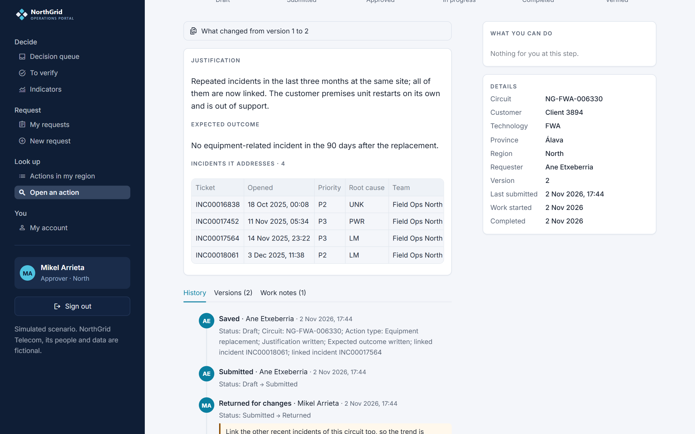
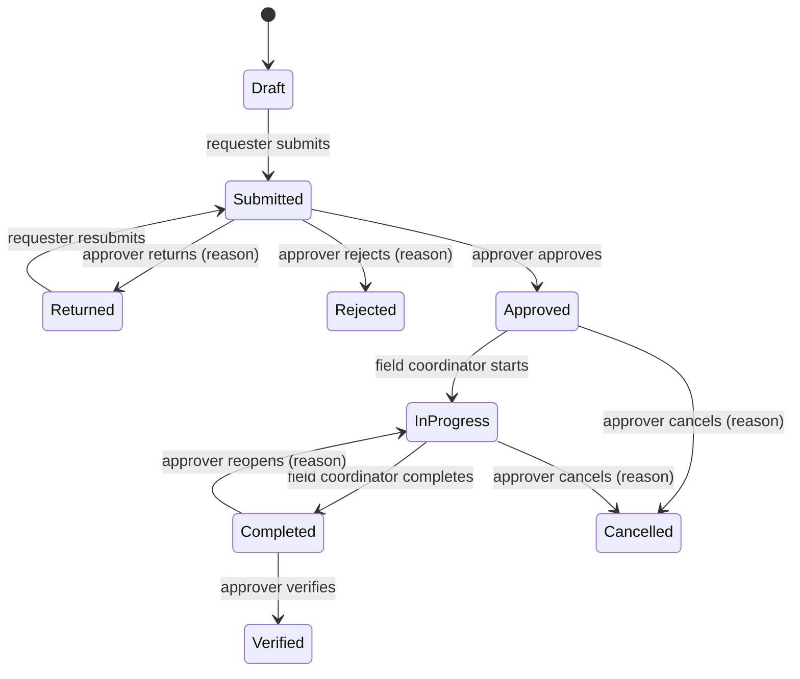
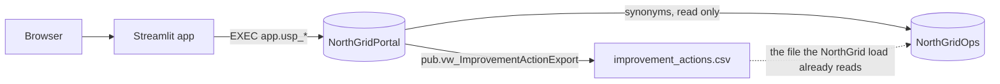
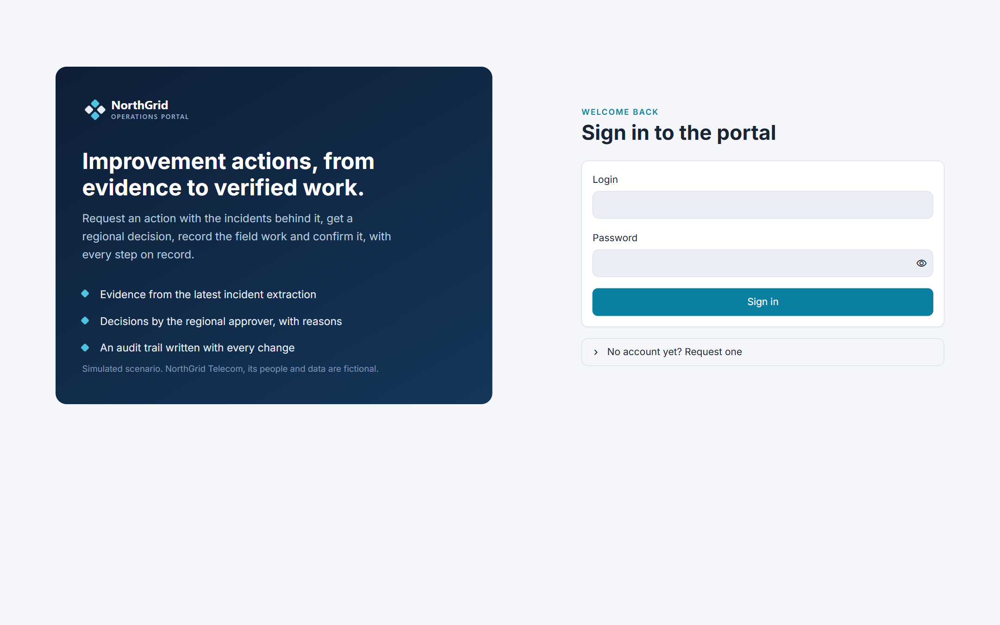
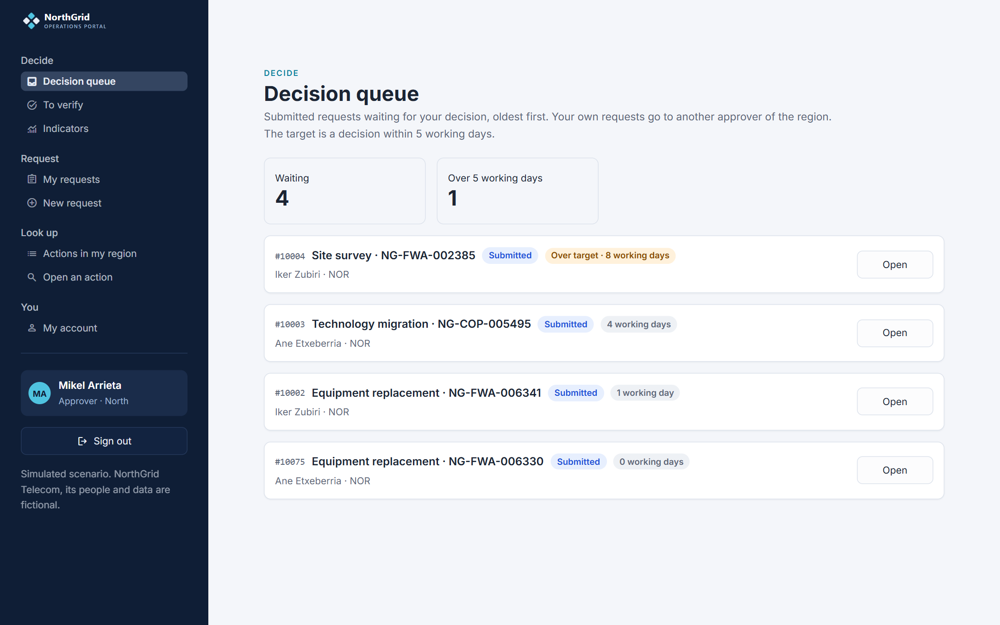
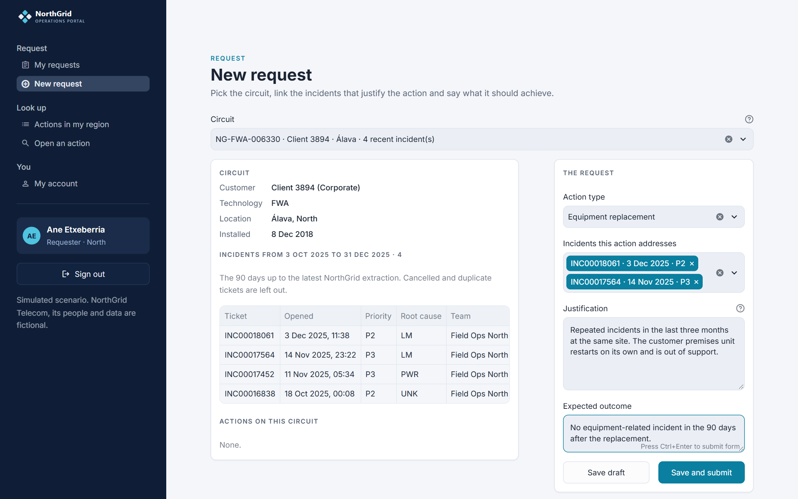
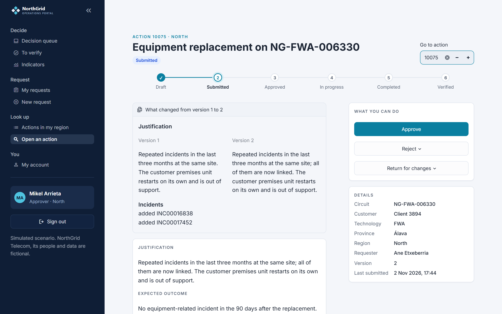

# Operations Management Portal

> Portfolio project by Gustavo Silveira, Senior Data & BI Analyst · Scylla Data Lab.
> **Simulated scenario:** NorthGrid Telecom S.A., its people, circuits and data are fictional.

An internal portal where improvement actions on business circuits are requested with their evidence, approved or
sent back by the regional manager, carried out by the field team and verified, with a trace of every decision. It
completes [Telecom Operations Intelligence](https://github.com/scylladl/telecom-operations-intelligence), the
analytics project for the same (fictional) operator: that report measures what actions achieve; this portal records
how they are chosen and done.

Built with **Python**, **Streamlit**, **SQL Server (T-SQL)** and PowerShell.



## In 30 seconds

| | |
|---|---|
| **The problem** | Actions were requested by e-mail and typed into a spreadsheet. Of 558 actions in two years, none records who asked, who approved or why; 28 were cancelled without a reason; the incidents behind them were not linked. |
| **What was delivered** | A role-based workflow (requester, approver, field coordinator, administrator) with evidence from the incident data, versions, reasons, an audit trail and follow-up indicators, plus an export that feeds the existing report without changing it. |
| **Where the rules live** | In SQL Server: every change is a stored procedure that checks role, region, ownership, transition and row version, and writes the audit trail in the same transaction. The screens only show what the database would allow. |
| **How it is verified** | 903 tests against a throwaway database, including every role × transition × status. Eight rules broken on purpose each make the suite fail. Indicators match an independent SQL query. The walkthrough screenshots are taken from the running app by a script. |

## The problem and the requirements

Fourteen rules were agreed with the (fictional) Head of B2B Service Assurance before the build
(`docs/01-business-requirements.md`), the last two from three formal changes after the architecture review
(`docs/02-change-log.md`). Among them: one open action per circuit and type; at least one incident of the last 90
days as evidence; nobody decides on or verifies their own request; reasons for returns, rejections, cancellations
and reopenings; every submitted version kept; nothing deleted after submission; concurrent edits never silently
overwritten.

## Workflow



## Solution



- **A separate database.** NorthGridOps reloads its action table from the client's export with `DELETE`, so the
  portal keeps its own database and reads circuits, customers and incidents through synonyms. NorthGridOps, its
  report and KPIs are unchanged.
- **Rules in the database, one list of transitions.** `ref.Transition` drives both the buttons on screen and the
  check in `app.usp_Transition`. Region, ownership and reason checks are in the same procedure.
- **Audit that cannot be skipped.** Triggers write who, when, the value before and after, and the reason, in the
  transaction of each change, and refuse changes made outside the procedures. The trail refuses updates and
  deletes.
- **Concurrency.** Row versions: of two simultaneous decisions one wins and the other is told the action changed.
- **Accounts.** Argon2id hashes, sign-up requests activated by an administrator, the account re-read on every
  click so disabling it takes effect at once. Secrets outside the repository.
- **History and the existing report.** The 558 historical actions are imported read-only; the export reproduces
  them row for row and adds the actions done through the portal in the same six columns.

Details: `docs/03-architecture.md` and `TECHNICAL_DECISIONS.md`.

## Screens

| | |
|---|---|
|  |  |
|  |  |

The design ("Service desk") is a navy sidebar with the NorthGrid mark and the signed-in user, a light canvas with
white cards, queues as cards with the waiting time, a stepper that shows where each action is in the workflow, and
the history as a timeline. It uses Streamlit's native theme (`.streamlit/config.toml`, Inter font) and a small
stylesheet (`assets/portal.css`) that touches only the portal's own HTML and keyed containers. Status colours pass
WCAG AA contrast, and every status is written, not shown by colour alone.

The full walkthrough, from draft to verified with a return, and a rejection: `docs/04-walkthrough.md`.

## Run it

Needs SQL Server with Windows authentication and the NorthGridOps database from
[Telecom Operations Intelligence](https://github.com/scylladl/telecom-operations-intelligence) (read only), ODBC
Driver 18 for SQL Server and Python 3.11+.

```bash
python -m venv .venv
.venv/Scripts/python -m pip install -r requirements.txt
```

```powershell
$env:PORTAL_DEMO_PASSWORD = "<a password of your choice>"
powershell -ExecutionPolicy Bypass -File build.ps1
.venv\Scripts\streamlit run app.py
```

`build.ps1` creates `NorthGridPortal`, loads the demo and runs the tests (about 20 s). Every demo account uses the
password you set. Some accounts:

| Login | Role | Region |
|---|---|---|
| `a.etxeberria` | Requester | North |
| `m.arrieta` | Approver | North |
| `u.otaegui` | Field coordinator | North |
| `admin` | Administrator | all |

To change the database, copy `.streamlit/secrets.example.toml` to `.streamlit/secrets.toml` or set
`PORTAL_DB_SERVER` / `PORTAL_DB_NAME`.

Checks:

```bash
.venv/Scripts/python -m pytest -q
```

```bash
.venv/Scripts/python validation/mutation_check.py
```

## Repository

| Path | Content |
|---|---|
| `docs/` | Requirements, change log, architecture, walkthrough, validation |
| `database/` | Numbered deployment scripts and `deploy.ps1` |
| `portal/` | Data access, authentication, accounts, Streamlit helpers |
| `app.py`, `pages/` | The Streamlit app |
| `scripts/` | Demo seed, export for the NorthGrid report, walkthrough capture |
| `tests/` | pytest suite against a throwaway database |
| `validation/` | Independent indicator query and the mutation check |
| `TECHNICAL_DECISIONS.md` | Why it is built this way, and what was given up |

## Limitations

Local deployment only, with Windows authentication (the app's restricted database role is created and tested, but
not used locally). No login throttling or session timeout, no notifications, no holiday calendar. Synthetic data.
See `docs/05-validation.md`.

## Contact

Gustavo Silveira · [LinkedIn](https://www.linkedin.com/in/gustavo-d-silveira-72b9b9218/) ·
[scylla.datalab@outlook.com](mailto:scylla.datalab@outlook.com). Available for Power BI, SQL Server and Python
projects, remote or in Spain.

## Resumen en español

Proyecto de portafolio con datos simulados: portal interno en Streamlit y SQL Server para solicitar, aprobar,
ejecutar y verificar acciones de mejora sobre circuitos de clientes empresariales de un operador ficticio. Cuatro
perfiles con autorización en el servidor (procedimientos almacenados que comprueban perfil, región, propiedad,
transición y versión de fila), auditoría escrita en la misma transacción por disparadores, control de concurrencia
optimista, contraseñas con Argon2id y una exportación que alimenta el informe existente sin modificarlo. 903
pruebas automáticas, una comprobación de que las pruebas detectan reglas rotas, e indicadores validados contra una
consulta SQL independiente.

## License

MIT, see `LICENSE`.
