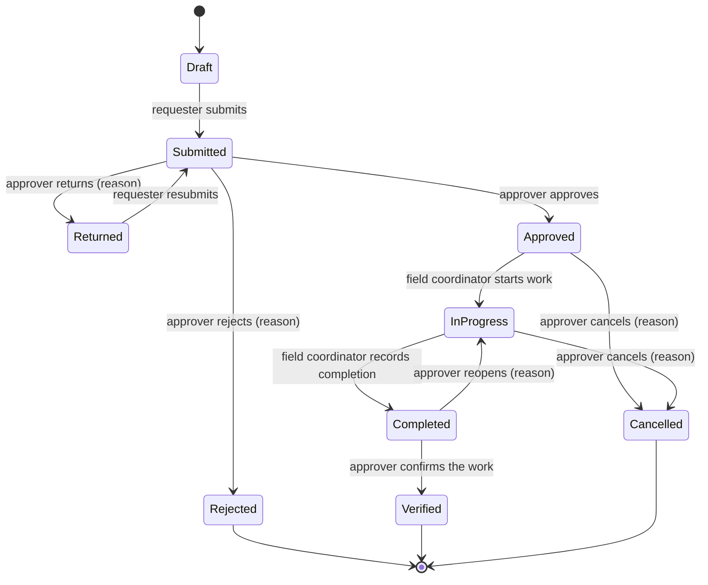

# Business Requirements

> **SIMULATED SCENARIO.** NorthGrid Telecom S.A., its people, circuits and every figure are fictional.

**Version 0.1, draft for approval** (2026-11-02). Written by the Head of B2B Service Assurance (fictional sponsor).
Nothing here is approved until the open questions in section 9 are answered.

## 1. Context

NorthGrid Telecom sells connectivity to business customers in Spain: about 6,500 circuits in six regions (North,
Northeast, East, Center, South, Northwest). When a circuit keeps failing, the regional teams run an **improvement
action** on it: a site survey, an equipment replacement, a re-routing or a technology migration.

The operations intelligence report (`telecom-operations-intelligence`) measures what happens afterwards. It cannot
say much about how the actions were chosen, because the record of each action is thin.

## 2. The problem

Today an action starts with an e-mail from a regional engineer to the regional manager, is approved by reply, and
is typed into a spreadsheet by whoever remembers. The export that reaches the data team has six columns: action,
circuit, type, start date, completion date and status. In the last two years (558 actions):

- nobody can say who asked for an action, who approved it or why;
- 28 actions were cancelled and none records a reason;
- the incidents that justified an action are not linked to it, so "was this the right circuit?" is answered from
  memory;
- 45 circuits received more than one action, and we cannot tell a planned second step from a duplicate request;
- the report showed that most of the drop in incidents after an action also happens on comparable circuits with no
  action. Choosing circuits on evidence matters more than we thought.

## 3. What we want

One internal portal where an action is requested with its evidence, approved or sent back by the regional manager,
executed and recorded by the field team, and confirmed as done, with a trace of every decision. The portal becomes
the place where improvement actions are recorded, replacing the e-mails and the spreadsheet.

## 4. Users

| Role | Who | What they do |
|---|---|---|
| Requester | Regional service engineers, NOC analysts | Propose actions for circuits of their region, answer returned requests, follow their requests |
| Approver | Regional service managers (one or two per region) | Approve, reject or return requests of their region; confirm completed work; cancel actions |
| Field coordinator | Field operations team leads | Record start, progress notes and completion of approved actions in their region |
| Administrator | Service assurance office | Manage users, roles and regions; see everything; cannot approve their own requests |

A person has one role and one region (administrators: all regions). Questions Q1 and Q5 may change this.

## 5. Workflow

## 6. Rules (proposed)

| # | Topic | Rule |
|---|---|---|
| R1 | Scope of an action | One action is for one circuit and one action type. A circuit cannot have two open actions (not Rejected, Verified or Cancelled) of the same type. |
| R2 | Evidence | When a requester picks a circuit, the portal shows its incidents of the last 90 days. A request needs a justification, the incidents it addresses (at least one) and the expected outcome. |
| R3 | Who decides | Only an approver of the circuit's region (or an administrator) decides on a request. Nobody approves, rejects or verifies an action they requested. |
| R4 | Reasons | Returning, rejecting, cancelling and reopening need a written reason. Approving does not. |
| R5 | Returned requests | A returned request goes back to its requester, who edits and resubmits it. Every submitted version is kept and the approver sees what changed. |
| R6 | Execution | Only a field coordinator of the circuit's region records work. Work can start only on approved actions. The completion date cannot be in the future or before the start date. |
| R7 | Nothing is deleted | Submitted requests are never deleted; they end as Rejected, Verified or Cancelled. Drafts can be discarded by their requester. |
| R8 | Change of owner | An administrator can move a request to another requester (for example when someone leaves), with a reason. |
| R9 | Audit trail | Every change of status or of a field records who, when, the value before and the value after, in the same database transaction as the change. The trail cannot be edited. |
| R10 | Visibility | Requesters see their own requests and, read-only, the open actions of their region. Approvers and field coordinators see their region. Administrators see everything. |
| R11 | Accounts | Accounts are created by an administrator, or requested by the user and activated by an administrator. Disabled accounts cannot sign in. Passwords are stored as slow salted hashes, never in clear. |
| R12 | Concurrent edits | If two people act on the same action at the same time, the second one is told the action changed and sees its current state; no decision is overwritten silently. |

## 7. Follow-up indicators (definitions to be validated before they are built)

| Indicator | Proposed definition |
|---|---|
| Waiting for decision | Submitted requests, by age since last submission (0–2, 3–5, over 5 working days) |
| Time to decision | Working days from first submission to approval or rejection |
| Return rate | Requests returned at least once ÷ requests decided |
| Time to complete | Calendar days from approval to completion |
| Actions by status | Count by status, region and action type |

## 8. Out of scope (version 1)

E-mail or chat notifications (the portal shows each user their own queue), file attachments, single sign-on,
cost and budget tracking, a mobile layout, and any change to the operations intelligence report or its KPIs.

## 9. Open questions

| # | Question | Proposed answer |
|---|---|---|
| Q1 | Is the field coordinator a separate role, or does the requester record the work? | Separate role: execution is done by field teams, not by the engineers who analyse the circuits. |
| Q2 | Does a completed action need a confirmation step (Verified), and who does it? | Yes, the approver of the region, so "done" means checked by the person who approved it. |
| Q3 | Do some action types need a second approval (for example technology migrations)? | No second level in version 1; the action type is visible to the approver. |
| Q4 | Is there a target time for decisions? | 5 working days; older requests are highlighted in the approver's queue. |
| Q5 | Can an approver also request actions? | Yes; their own requests go to another approver of the region or to an administrator (R3). |
| Q6 | What happens to the 558 historical actions? | Imported read-only as history (status and dates as they are, requester and approver "not recorded"), so circuits show their past actions. |
| Q7 | Must actions recorded in the portal reach the operations intelligence report? | Yes, eventually: the portal becomes the source of improvement actions. How, and whether the report changes, is decided with the architecture, without changing its approved KPIs. |

## 10. Acceptance criteria (proposed)

| # | Criterion |
|---|---|
| AC-01 | One command creates the database objects and loads the demo data. |
| AC-02 | Each role can do exactly what section 4 and the rules allow; the backend refuses everything else, and automated tests cover every role and transition. |
| AC-03 | Every change writes its audit record in the same transaction; a test proves that a failed change leaves neither the change nor the audit record. |
| AC-04 | Two people deciding on the same action at the same time cannot both succeed (R12), covered by a test. |
| AC-05 | No password, connection string or personal data is committed; an example configuration file shows the settings. |
| AC-06 | A documented walkthrough, with screenshots taken from the running app, follows one request from draft to verified, including a return and a rejection. |
| AC-07 | The follow-up indicators, once their definitions are approved, match independent SQL queries. |
