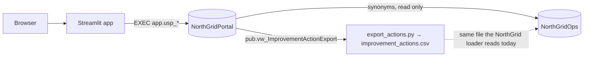

# Architecture

> **SIMULATED SCENARIO.** NorthGrid Telecom and all its data are fictional.

**Status: proposal for approval** (2026-11-02). Nothing below is built yet.

## 1. Where the portal's data lives

### What the existing database does with improvement actions

`NorthGridOps` (project `telecom-operations-intelligence`) is an analytics database. Its `ops` schema is a landing
zone for the client's exports: `database/load_source_data.ps1` runs `DELETE FROM ops.ImprovementAction` and reloads
the table from `improvement_actions.csv` on every load. `dw.usp_Refresh` fingerprints `ops.ImprovementAction` to
decide whether to rebuild the warehouse.

A portal that wrote into `ops.ImprovementAction` would lose its rows on the next export load, and every decision
would change the fingerprint and trigger a warehouse rebuild.

### Proposal: a separate database, `NorthGridPortal`, on the same instance

| | Separate database (proposed) | `portal` schema inside `NorthGridOps` |
|---|---|---|
| NorthGridOps changes | None | New schema, tables, procedures and a role in a database the report depends on |
| Lifecycle | Transactional system of record: point-in-time backups, audit retention | Analytics: rebuilt from exports, simple recovery is enough |
| Permissions | The portal's login writes only to its own database and reads four NorthGridOps tables | The portal's login is a user of the analytics database |
| Foreign keys to circuits and incidents | Not possible across databases; checked in the procedures | Possible |
| Operations | Two databases to deploy and back up | One |

**Integrations.** The portal reads `ops.Circuit`, `ops.Incident`, `ref.Region` and `ref.ActionType` from NorthGridOps
through synonyms in a `ng` schema (`ng.Circuit` → `NorthGridOps.ops.Circuit`). Nothing is copied, so reference data
cannot drift. NorthGridOps receives nothing from the portal directly; see section 7.

**Maintenance cost.**
- The synonyms assume both databases on one instance. Moving either one means a linked server or a copy job.
- A circuit that disappears from a later inventory export is not caught by a foreign key. Procedures check that
  circuits and incidents exist when a request is saved, and a data quality check flags actions whose circuit is gone.
- There are two deployments; one `build.ps1` deploys the portal and leaves NorthGridOps untouched.

## 2. Components



## 3. Database design

| Schema | Contents |
|---|---|
| `ref` | `Role`, `Status` (with `IsOpen`), `Transition` (from status, to status, action, allowed role, reason required) |
| `ng` | Synonyms to NorthGridOps reference and incident tables |
| `app` | `UserAccount`, `Action`, `ActionIncident`, `ActionVersion`, `ActionVersionIncident`, `WorkNote`, and the stored procedures the app calls |
| `audit` | `ActionEvent`, `UserEvent`: insert-only |
| `rpt` | Views behind the follow-up indicators |
| `pub` | `vw_ImprovementActionExport`: actions in the NorthGrid export format |

Key columns of `app.Action`: `ActionId`, `CircuitId`, `ActionTypeCode`, `RegionCode` (copied from the circuit when
the request is created, so routing does not change if the inventory does), `Status`, `RequesterId`, `Justification`,
`ExpectedOutcome`, `StartDate`, `CompletionDate`, `IsHistorical`, and `RowVer rowversion`.

**R1 (no duplicate open action)** is a filtered unique index on `(CircuitId, ActionTypeCode)` over open statuses
of non-historical actions, so it holds under concurrency, not only in the form.

**R5 (versions).** A draft is edited in place. Each submission snapshots the request and its incident links into
`ActionVersion`, and the approver sees the difference between the last two versions.

## 4. Workflow enforcement and authorization

Every change goes through one stored procedure per command (`app.usp_SubmitAction`, `app.usp_DecideAction`,
`app.usp_RecordWork`, …). Each one, inside a single transaction:

1. reads the actor's account and refuses a disabled one;
2. looks up the transition in `ref.Transition` and refuses it if the actor's role is not allowed;
3. checks the region (R3, R6, R10) and that the actor is not the requester when deciding or verifying (R3);
4. checks the reason when the transition needs one (R4) and the dates (R6);
5. updates the action only if `RowVer` still equals the value the user saw; otherwise it raises "this action
   changed" and nothing is written (R12);
6. writes the audit rows (R9).

`SET XACT_ABORT ON` and one transaction per command mean a failure anywhere leaves neither the change nor its audit
record (AC-03).

The app calls the same procedures for every role. Hiding a button in the interface is a convenience; the procedure
is what refuses. The interface reads `ref.Transition` to decide which buttons to show, so the interface and the
database use one list of rules.

The database trusts the app for *who* the user is (the app authenticates) and decides *what that user may do*. The
app's database role has `EXECUTE` on `app` procedures and `SELECT` on `rpt` and `pub` views, and no direct table
permissions. Locally the app connects with Windows authentication, which bypasses that role. The role is created
and tested, but a production deployment would use a dedicated login mapped to it.

The audit tables are insert-only: the app role has no `UPDATE` or `DELETE`, and a trigger refuses both for anyone
else.

## 5. Application

```
portal/
  app.py            sign-in, navigation by role
  db.py             connection from secrets, procedure calls, error mapping
  auth.py           Argon2id hashing and verification (argon2-cffi)
  actions.py        queries and commands for actions
  users.py          account administration
  pages/            my requests, new request, approval queue, field work, action detail, indicators, users
database/           numbered scripts, deploy.ps1
scripts/            seed_demo.py, export_actions.py
tests/              pytest against a separate test database
build.ps1           AC-01: deploy, seed, run tests
```

There is no separate service layer: the rules live in the procedures, and a Python layer repeating them would be two
copies to keep in step.

**Sessions.** After sign-in, `st.session_state` holds only the user id. Each page run reloads the account, so a
disabled account or a changed role takes effect on the next click, not at the next sign-in.

**Cache.** `st.cache_data` is used only for data that is the same for every user: action types, regions and the
circuit list. Queues, action details and indicators are always read fresh, so no user sees another user's cached
results.

**Configuration and secrets.** `.streamlit/secrets.toml` holds the server and database names. It is gitignored, and
`.streamlit/secrets.example.toml` is committed. No password exists in the repository: `seed_demo.py` takes the demo
users' password from the `PORTAL_DEMO_PASSWORD` environment variable.

## 6. Data

**Historical actions (Q6).** The 558 actions are imported with their original ids, status and dates, and
`IsHistorical = 1`. They have no requester, approver, evidence or versions, and the portal shows them read-only on
the circuit page. New actions start at id 10001, so the two ranges never collide.

**Demo users.** One administrator. Per region: two requesters, one field coordinator and one approver; two regions
get a second approver, so Q5 (an approver's own request decided by another approver) can be shown. Names are
fictional.

**Demo requests.** About 60 requests across all statuses, with submission times relative to the day the seed runs.
This way the 5-working-day highlight (Q4) and the indicators show real ages.

**Evidence window (R2).** The NorthGrid incident data ends on 2025-12-31. The "last 90 days" are counted back from
the latest incident in the extraction, not from today. The same applies in real operation: the portal can show only
what the last extraction loaded. The page states the date the window ends.

**Working days** are Monday to Friday. There is no holiday calendar in version 1.

## 7. Reaching the operations intelligence report (Q7)

`pub.vw_ImprovementActionExport` returns actions in the six columns of `improvement_actions.csv`, and
`scripts/export_actions.py` writes that file:

| Portal status | Exported as |
|---|---|
| Approved, not started | not exported (the export needs a start date) |
| InProgress | `In progress` |
| Completed, Verified | `Completed` |
| Cancelled after work started | `Cancelled` |
| Draft, Submitted, Returned, Rejected, Cancelled before start | not exported (never became work) |
| Historical | as imported |

The NorthGrid loader reads this file unchanged, so the report and its KPIs need no change. Replacing the
spreadsheet export with this file is an operations step, outside both repositories. A test proves that exporting
only the historical actions reproduces `NorthGridOps.ops.ImprovementAction` row for row.

## 8. Tests (AC-02 to AC-04, AC-07)

| Test | What it proves |
|---|---|
| Transition matrix | Every role × transition × own/other region × own/other request: allowed ones succeed, the rest are refused by the procedure |
| Audit atomicity | A trigger added in the test database makes the audit insert fail; the action is unchanged and no audit row exists |
| Concurrency | Two connections decide on the same action with the same `RowVer`; exactly one succeeds |
| Accounts | Disabled accounts cannot sign in; hashes are Argon2id; a wrong password fails |
| Duplicate rule | A second open action of the same type on a circuit is refused |
| Indicators | Each `rpt` view matches an independent SQL query |
| Export round trip | Historical rows match `NorthGridOps.ops.ImprovementAction` exactly |

The tests run against `NorthGridPortal_Test`, created and dropped by the test run, so the demo data is never
modified by tests.
