# Walkthrough

> **SIMULATED SCENARIO.** NorthGrid Telecom, its people and data are fictional.

AC-06: one request from draft to verified, with a return, and a rejection. Every screenshot was taken from the
running app by `scripts/capture_walkthrough.py`, which drives the screens in Microsoft Edge the way a user would
(Playwright) on a freshly built demo. Running it again reproduces the sequence; the action number and dates
depend on the day it runs.

## 1. A requester proposes an action

Ane Etxeberria, a service engineer of the North region, signs in and sees her requests.

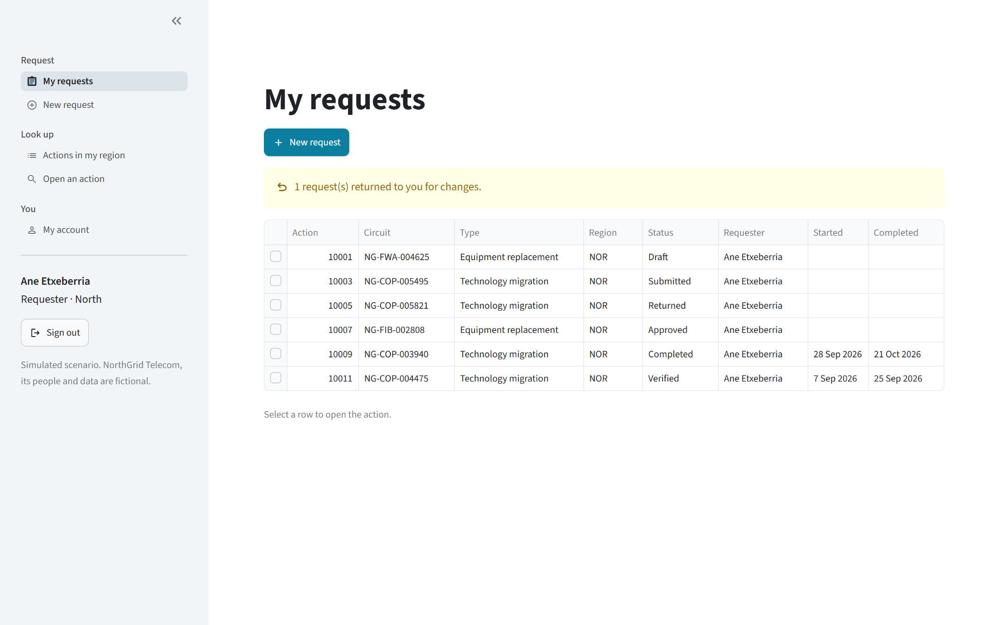

She picks a circuit. The portal shows its incidents of the evidence window (the 90 days up to the latest NorthGrid
extraction, 3 October to 31 December 2025) and the actions already recorded on it, including those from before
the portal. She links two incidents, writes the justification and the expected outcome, and submits.

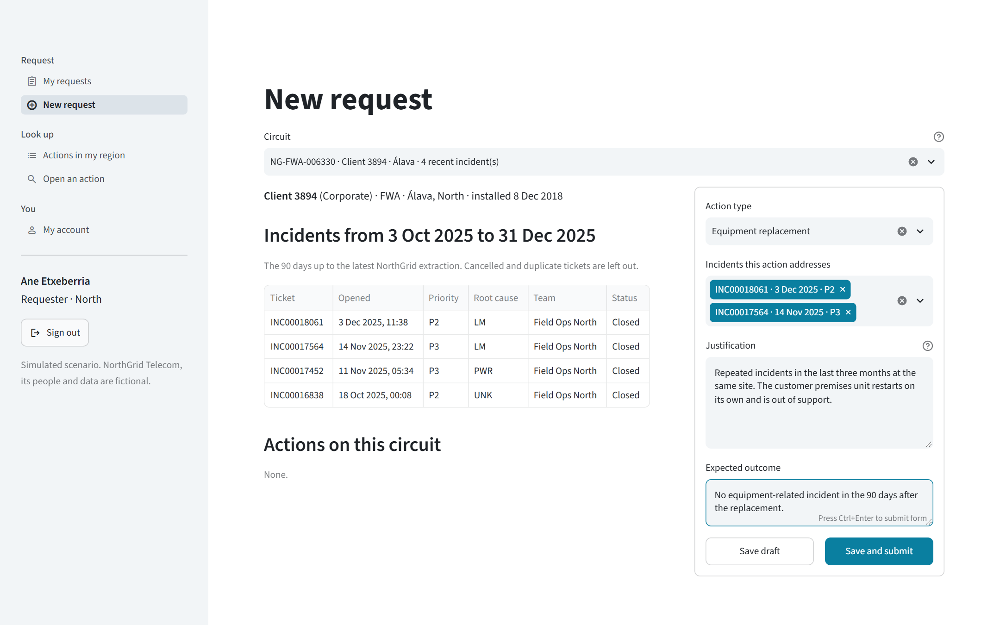

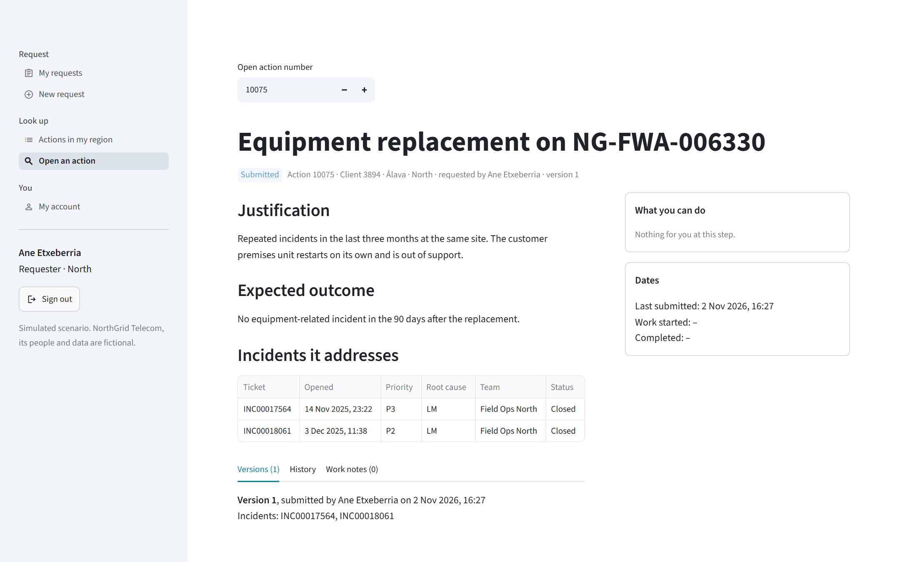

## 2. The approver returns it

Mikel Arrieta, approver of the North region, has it in his decision queue. Requests waiting more than five working
days are highlighted (Q4).

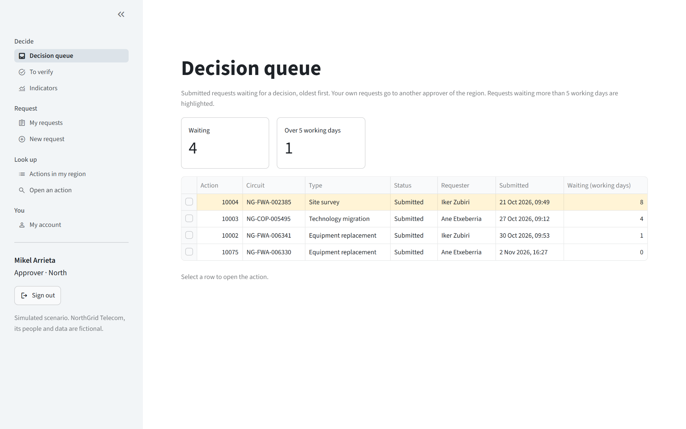

He returns it and writes why; a reason is required (R4). The requester and the history see it.

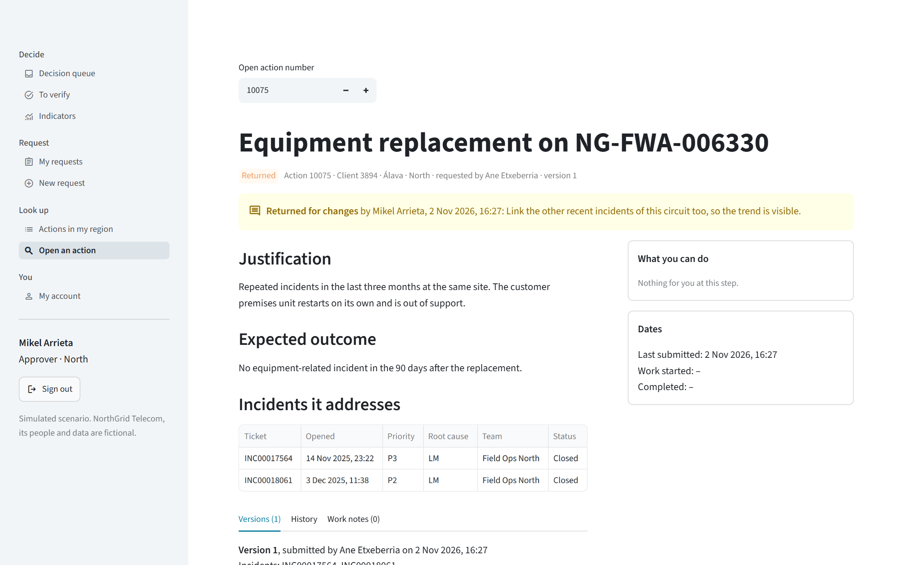

## 3. The requester edits and resubmits

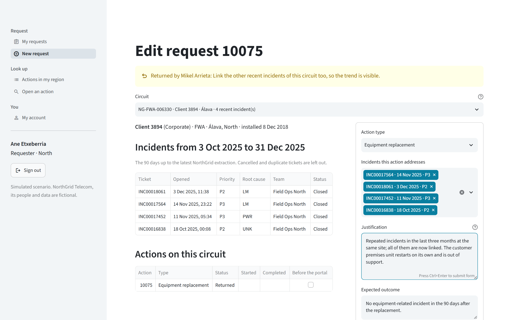

## 4. The approver sees what changed and approves

Version 2 is compared with version 1 (R5): the justification side by side, and the incidents added.

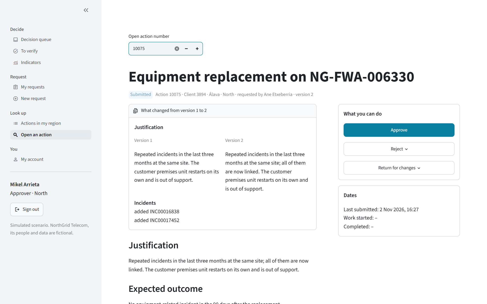

## 5. The field coordinator does the work

Unai Otaegui, field coordinator of the North region, sees the approved actions to start and the ones in progress,
including a historical action still open whose completion he can record (R14).

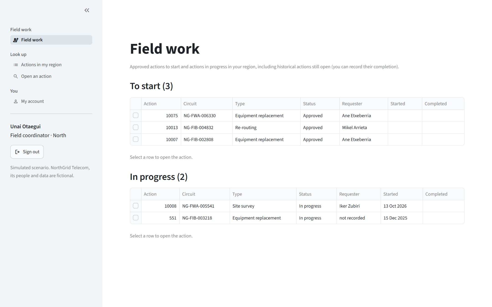

He records the start, a work note and the completion. The dates cannot be in the future, and the completion cannot
be before the start (R6).

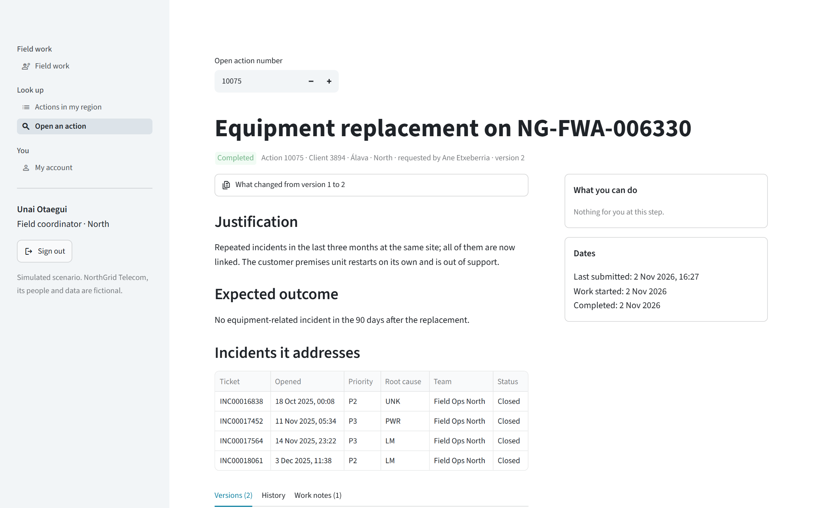

## 6. The approver verifies it

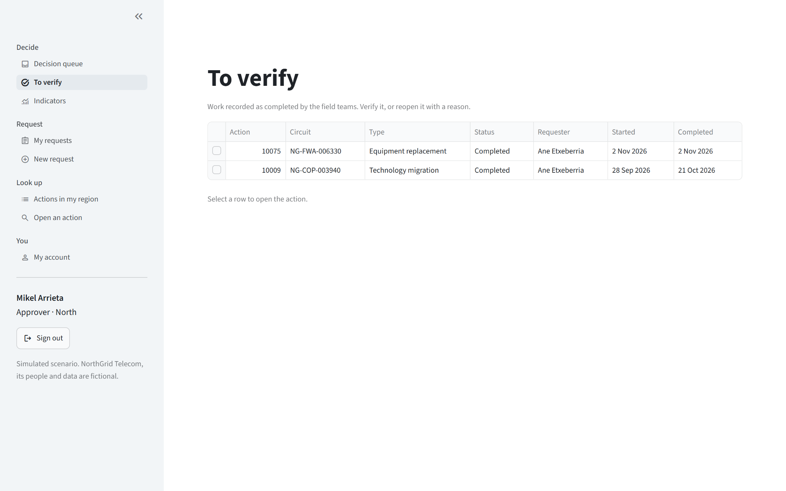

The history lists every change with who, when, the value before and after, and the reasons, as the database wrote
it in the transaction of each change (R9).

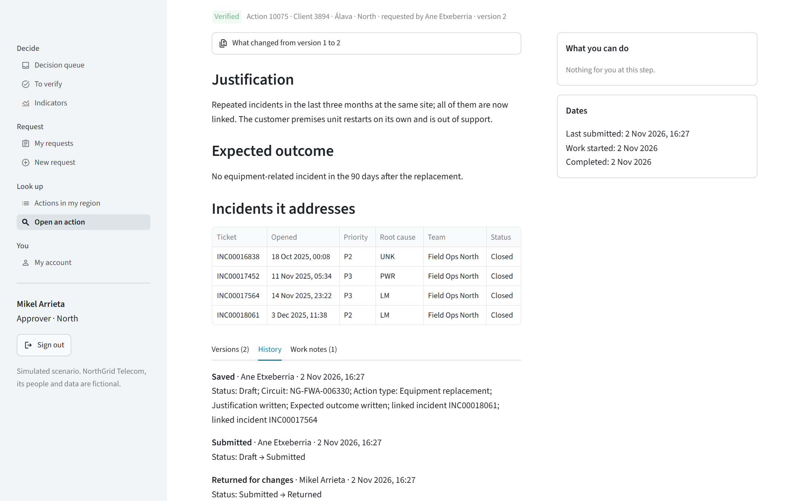

## 7. A rejection

Another request of the region is rejected with its reason.

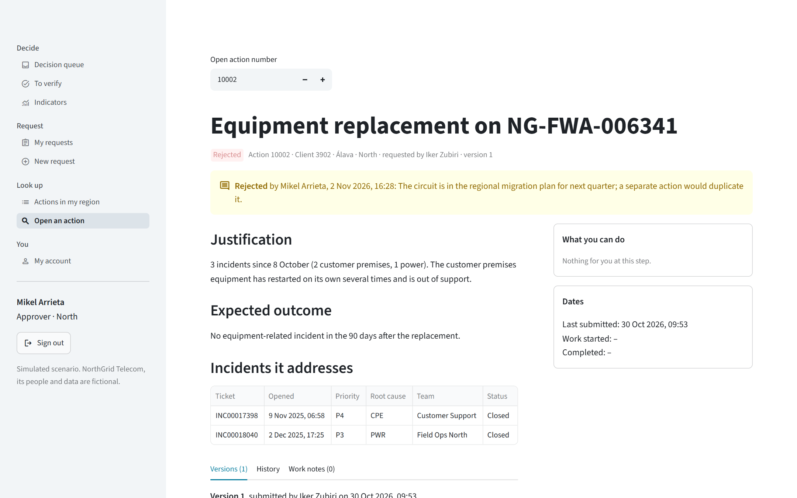

## 8. Indicators and administration

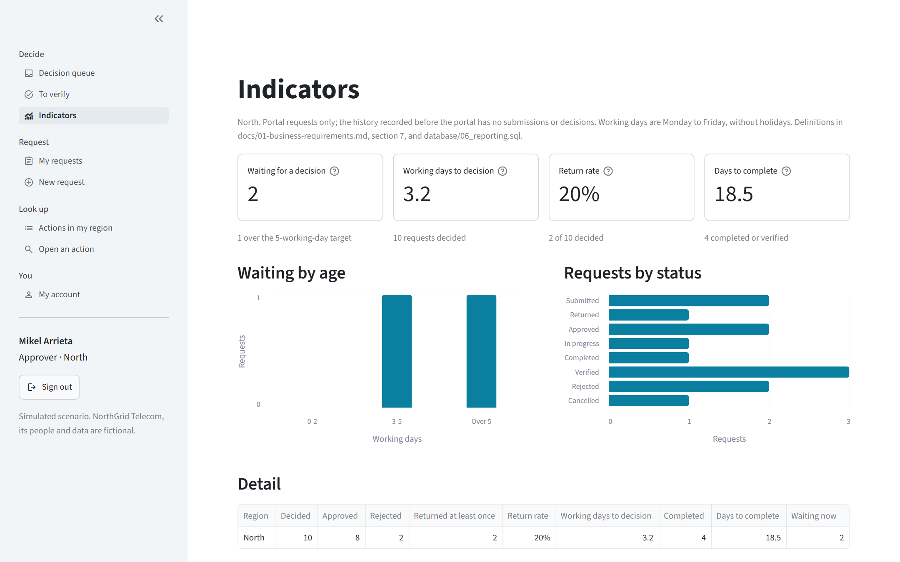

The administrator sees every region, activates sign-up requests and manages roles and regions (R11).

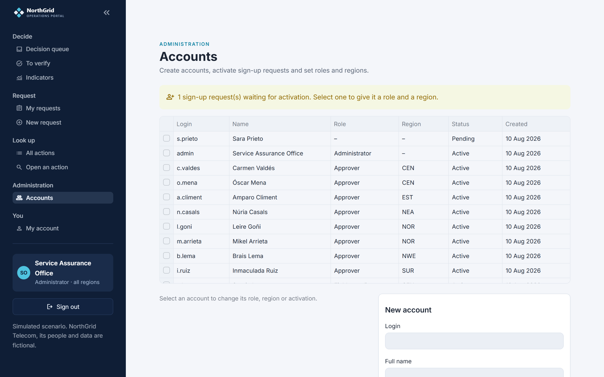

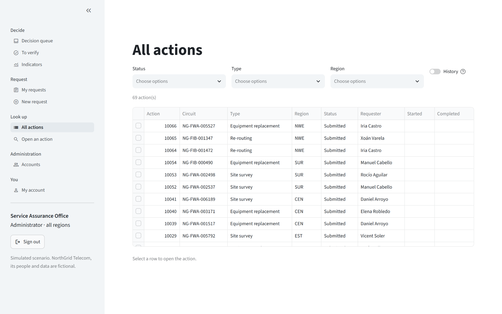
